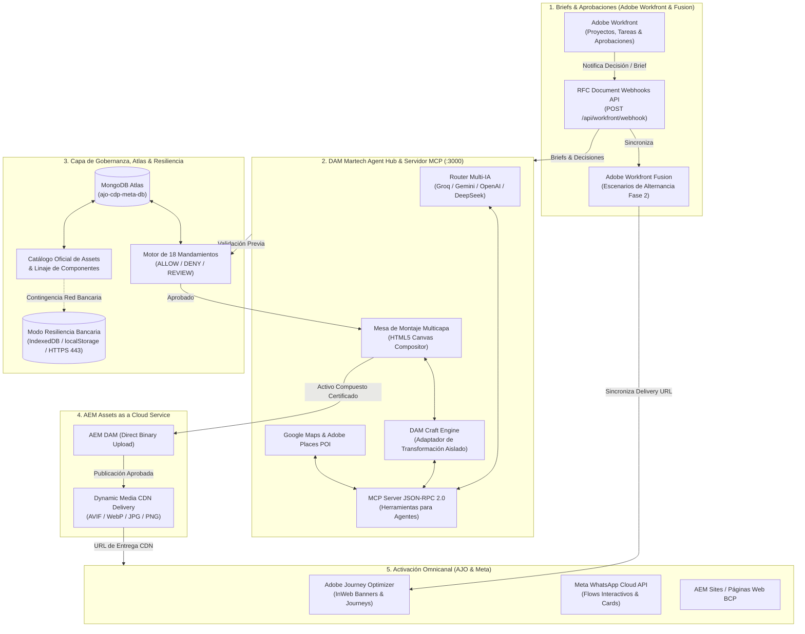
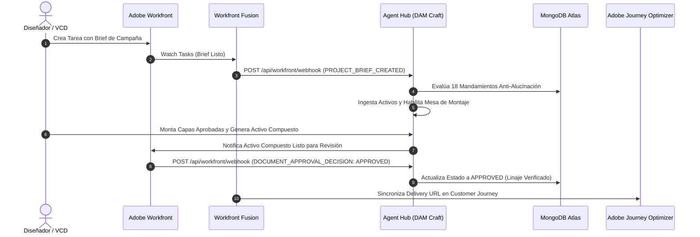

# 🏦 Martech Engineer — Dynamic Media, AEM Assets, Adobe Journey Optimizer, Workfront & AI Agent Hub

[](pom.xml)
[](Dockerfile)
[](agent-hub/services/governanceEngine.mjs)
[](mcp-server/mcp_server.mjs)
[](agent-hub/services/damcraftAdapter.mjs)
[](agent-hub/services/workfrontService.mjs)
[](agent-hub/services/workfrontService.mjs)

> **Principio Rector:** *Orquestar, Gobernar, Componer y Auditar.*  
> **Adobe Workfront & Fusion** gestionan briefs creativos, casos de uso y decisiones formales de aprobación/rechazo documental.  
> **AEM Assets / DAM** custodia los binarios maestros oficiales y la distribución CDN de alta velocidad mediante **Dynamic Media**.  
> **MongoDB Atlas** almacena el catálogo de iniciativas, los 18 mandamientos de marca BCP y la trazabilidad inmutable (*Audit Trail*).  
> **DAM Craft & Mesa de Montaje Multicapa** permiten la carga masiva y el traslape de piezas pre-aprobadas con linaje de componentes (`parentAssetIds`).  
> **Agent Hub & Servidor MCP** orquestan proveedores de IA y herramientas para agentes autónomos bajo supervisión humana (*Human-in-the-Loop*).

---

## 📑 Tabla de Contenidos

1. [Arquitectura de Solución (Fase 2)](#-arquitectura-de-solución-fase-2)
2. [Estructura del Proyecto y Carpetas](#-estructura-del-proyecto-y-carpetas)
3. [Integración con Adobe Workfront & Workfront Fusion](#-integración-con-adobe-workfront--workfront-fusion)
4. [Mesa de Montaje Multicapa y Carga Masiva (Batch Upload)](#-mesa-de-montaje-multicapa-y-carga-masiva-batch-upload)
5. [Modo Explicativo Interactivo ("Inspector Martech")](#-modo-explicativo-interactivo-inspector-martech)
6. [DAM Craft: Motor de Transformación y Servidor MCP](#-dam-craft-motor-de-transformación-y-servidor-mcp)
7. [Router Multi-Proveedor de IA y Rotación de API Keys](#-router-multi-proveedor-de-ia-y-rotación-de-api-keys)
8. [Gobernanza con MongoDB Atlas y los 18 Mandamientos](#-gobernanza-con-mongodb-atlas-y-los-18-mandamientos)
9. [Análisis de Red Bancaria (Puerto 27017) y Despliegue en GitHub Pages](#-análisis-de-red-bancaria-puerto-27017-y-despliegue-en-github-pages)
10. [Contexto Geográfico: Google Places & Adobe Places](#-contexto-geográfico-google-places--adobe-places)
11. [Flow Studio: Generador Dinámico de Entendimiento](#-flow-studio-generador-dinámico-de-entendimiento)
12. [Guía de Ejecución en Local y Pruebas](#-guía-de-ejecución-en-local-y-pruebas)
13. [Dockerización y GitHub Actions](#-dockerización-y-github-actions)
14. [Hoja de Ruta de Integración Bancaria y Fase 2](#-hoja-de-ruta-de-integración-bancaria-y-fase-2)

---

## 🏛️ Arquitectura de Solución (Fase 2)



---

## 📂 Estructura del Proyecto y Carpetas

El repositorio está **100% alineado**: el reactor raíz Maven `pom.xml`, los flujos CI/CD de GitHub Actions, Dockerfile y el servidor de agentes conviven armónicamente:

```
.
├── pom.xml                               # Reactor raíz Maven AEM (12 módulos)
├── Dockerfile                            # Imagen multi-stage: AEM + Node.js + DAM Craft
├── docker-compose.yml                    # Orquestación de servicios en local
├── package.json                          # Dependencias y scripts de Agent Hub & MCP
├── Mandamiento para IA.md                # Constitución técnica y los 18 mandamientos
├── .env.local                            # Credenciales locales (ignorado en Git)
├── .env.example                          # Plantilla documentada de variables de entorno
│
├── core/                                 # Módulo Java OSGi: Servlets, Sling Models y servicios
├── ui.apps/                              # Componentes AEM, dialogs y clientlibs (/apps)
├── ui.apps.structure/                    # Definición de estructura de repositorio JCR
├── ui.config/                            # Configuraciones OSGi por runmode (author, publish)
├── ui.content/                           # Paquete de contenido DAM de muestra y filtros FileVault
├── ui.frontend/                          # Pipeline Webpack / React para componentes AEM
├── all/                                  # Paquete general AEM (All-in-one para Cloud Manager)
├── it.tests/                             # Pruebas de integración Java / Sling
├── dispatcher/ & dispatcher.ams/         # Reglas de Apache / Dispatcher y caché
├── ui.tests/                             # Pruebas funcionales Cypress para Cloud Service
│
├── agent-hub/                            # 🚀 Orquestador de Agentes, API REST & Dashboard
│   ├── server.mjs                        # Servidor HTTP Express (Dashboard en :3000)
│   ├── services/
│   │   ├── workfrontService.mjs          # Implementación de Workfront Document Webhooks & Fusion
│   │   ├── damcraftAdapter.mjs         # Adaptador puente DAM Craft (executeDamCraftEdit)
│   │   ├── assetEditorService.mjs        # Servicio de dominio para edición y traslape
│   │   ├── governanceEngine.mjs          # Validación de 18 mandamientos en MongoDB Atlas
│   │   ├── providerRouter.mjs            # Router con rotación de keys y fallback de modelos
│   │   ├── authService.mjs               # Autenticación, RBAC y gestión de pestañas
│   │   ├── storageAdapter.mjs            # Persistencia híbrida (MongoDB Atlas / local JSON)
│   │   └── placesService.mjs             # Enriquecimiento con Google Places y Adobe Places
│   ├── public/
│   │   └── index.html                    # Dashboard web interactivo: Workfront, Compositor & Inspector
│   └── tests/                            # Suites de pruebas automáticas (Gobernanza, Router, Workfront)
│
├── mcp-server/                           # 🔌 Servidor Model Context Protocol (JSON-RPC 2.0)
│   └── mcp_server.mjs                    # Herramientas expuestas para agentes Claude/Cursor/AGY
│
├── flow_studio/                          # ⚡ Flow Studio: Entendimiento Dinámico
│   ├── generator.mjs                     # Inyector de modelos JSON a mapas interactivos
│   └── public/index.html                 # UI de diseño, inspección de nodos y descarga HTML
│
└── resources/                            # 📚 Material de entendimiento y handoffs técnicos
    ├── flow-template.html                # Plantilla base de diagramas interactivos
    ├── diagrama en html modelo.html      # Diagrama de referencia BCP WhatsApp + AJO + Azure
    └── ARRANQUE_PROYECTO_*.md            # Notas de continuidad técnica
```

---

## 🔗 Integración con Adobe Workfront & Workfront Fusion

El proyecto implementa la especificación oficial de [Adobe Workfront Document Webhooks API](https://experienceleague.adobe.com/en/docs/workfront/using/adobe-workfront-api/document-webhooks-api/docu-webhook-api) para integrar el flujo creativo de extremo a extremo.

### A. Endpoints Implementados en el Agent Hub

| Método | Endpoint | Estándar / Función |
| :---: | :--- | :--- |
| `GET` | `/api/workfront/metadata` | **Metadatos RFC Provider:** Informa a Workfront las capacidades del hub (`documentUpload`, `approvalDelegation`, `fusionOrchestration`). |
| `POST` | `/api/workfront/webhook` | **Receptor RFC Webhook:** Procesa eventos de Workfront (`DOCUMENT_APPROVAL_DECISION`, `DOCUMENT_REJECTED`, `PROJECT_BRIEF_CREATED`). |
| `POST` | `/api/workfront/fusion/trigger` | **Disparador Fusion:** Dispara escenarios de orquestación en Adobe Workfront Fusion (Integromat) sobre HTTPS 443. |
| `GET` | `/api/workfront/events` | **Consola de Auditoría:** Lista los eventos recientes, actores y cambios de estado procesados. |
| `POST` | `/api/workfront/simulate-event` | **Simulador Interactivo:** Permite emular aprobaciones o ingestas de briefs desde la UI para pruebas sin conexión externa. |

### B. Configuración Paso a Paso en Adobe Workfront

1. **Acceso de Administrador:** En Workfront, navegue a **Setup** > **Documents** > **Custom Integrations** (o **Document Webhook Providers**).
2. **Crear Proveedor:** Haga clic en **Add Custom Integration** y configure:
   - **Name:** `BCP DAM Craft Integration`
   - **Base URL:** `https://<tu-host-o-tunel>/api/workfront`
   - **Webhook URL:** `https://<tu-host-o-tunel>/api/workfront/webhook`
   - **Metadata Endpoint:** `https://<tu-host-o-tunel>/api/workfront/metadata`
   - **Authentication:** `API Key` o `OAuth 2.0 Server-to-Server`.
3. **Validación:** Al guardar, Workfront ejecutará automáticamente un `GET /api/workfront/metadata` confirmando la interoperabilidad HTTP 200:
   ```json
   {
     "name": "BCP DAM Craft Integration",
     "version": "2.0.0-STAGE2",
     "capabilities": {
       "documentUpload": true,
       "approvalDelegation": true,
       "fusionOrchestration": true,
       "multiAssetComposition": true
     }
   }
   ```

### C. Escenarios de Adobe Workfront Fusion (Integromat)

La pestaña **04 · Workfront & Fusion** del Dashboard permite alternar el comportamiento de la Fase 2 mediante 3 escenarios preconfigurados:



* **Escenario 1 (`SCENARIO_1_BRIEF_TO_DAMCRAFT`):** Ingesta briefs desde tareas de Workfront, valida las directrices de marca en MongoDB y enruta los requerimientos hacia el motor de variantes DAM Craft.
* **Escenario 2 (`SCENARIO_2_COMPOSITING_APPROVAL`):** Al generarse un activo compuesto en la Mesa de Montaje, envía la pieza a la cola de aprobación formal de Workfront con su lista de piezas parentales (`parentAssetIds`).
* **Escenario 3 (`SCENARIO_3_AJO_ACTIVATION`):** Cuando la pieza recibe la aprobación formal en Workfront, Fusion sincroniza la URL de Dynamic Media en el journey de AJO y activa la entrega.

---

## 🧩 Mesa de Montaje Multicapa y Carga Masiva (Batch Upload)

Ubicada en la sección **Catálogo DAM** (`tab-catalog`), esta funcionalidad resuelve la necesidad de los equipos creativos de construir piezas complejas combinando componentes previamente autorizados:

### 1. Carga Masiva de Activos (Batch Asset Upload)
* **Ingesta Simultánea:** Zona de arrastrar y soltar (`drag & drop`) que procesa múltiples archivos en una sola operación (`POST /api/catalog/batch-upload`).
* **Clasificación Automática:** Permite asignar en bloque la **Iniciativa BCP** (`INIT-BCP-CAMP-2026-01`, etc.) y la **Categoría del Componente**:
  - `FONDO / HERO`: Fondos de alto impacto visual.
  - `BADGE / SELLO`: Sellos oficiales de promoción y porcentaje de descuento.
  - `STICKER / BENEFICIO`: Íconos de beneficios de tarjetas y préstamos.
  - `TIPOGRAFÍA / CTA`: Botones de llamado a la acción y titulares.
* **Control de Formatos:** Admite y valida extensiones PNG, JPG, WebP, SVG y AVIF.

### 2. Mesa de Montaje Multicapa (Canvas Compositor)
* **Lienzo HTML5 Interactivo:** Permite componer piezas en tiempo real con selectores de resolución de canal oficiales:
  - `1080x1080`: Cuadrado oficial (Instagram Feed / WhatsApp Flow 1:1).
  - `1200x628`: Banner estándar de Adobe Journey Optimizer (InWeb).
  - `800x800`: Cabecera de tarjeta interactiva de WhatsApp.
  - `1920x1080`: Banner hero para páginas AEM Sites.
* **Biblioteca de Piezas Aprobadas:** Filtra y lista exclusivamente activos del catálogo que posean estado `APPROVED` con botón de inserción rápida `+ Capa`.
* **Pila de Capas (Layer Stack Manager):**
  - **Z-Index:** Reordenamiento hacia arriba (▲) o hacia abajo (▼) en la pila de profundidad.
  - **Posición Espacial:** Ajuste de coordenadas `(X, Y)` en el lienzo.
  - **Escala / Zoom:** Control deslizante de 20% a 200% preservando proporciones originales.
  - **Opacidad:** Regulador de transparencia de 10% a 100%.
  - **Modos de Fusión (Blend Modes):** `Normal (source-over)`, `Multiply`, `Screen`, `Overlay`.
* **Trazabilidad y Linaje (`parentAssetIds`):**
  Al presionar **✨ Generar y Certificar Activo**, el motor fusiona las capas, genera la imagen de alta definición (`image/png` / `image/svg+xml`), calcula el hash de auditoría y registra el nuevo activo en el DAM almacenando el array de IDs de las piezas que lo conforman. Esto garantiza que el nuevo activo **hereda la legitimidad de sus partes base** sin exigir una re-aprobación completa desde cero.

---

## 💡 Modo Explicativo Interactivo ("Inspector Martech")

Para facilitar el autoservicio, la capacitación y la auditoría operativa:

1. **Botón en Encabezado:** En la barra superior de la aplicación se encuentra el selector:
   `[💡 Modo Explicativo]`
2. **Comportamiento Visual:** Al activarse, el cursor adopta estilo de ayuda (`help`) y los controles interactivos muestran un borde punteado sutil.
3. **Modal Contextual al Hacer Click:** Al hacer clic en **cualquier campo de texto, selector, botón o pestaña**, se despliega el modal interactivo con 4 secciones clave:
   - **¿Qué es este elemento?:** Definición clara del control en lenguaje de negocio.
   - **Rol en el Flujo / Fase 2:** Cómo impacta en Adobe Workfront, Fusion, DAM Craft, Dynamic Media o AJO.
   - **Validaciones y Gobernanza:** Mandamiento de marca aplicable, restricciones de cuota o reglas anti-alucinación.
   - **Identificador Técnico:** Tag HTML y selector CSS exacto (`#id`).
4. Cuenta con un diccionario exhaustivo precargado para más de 30 campos del sistema y un motor de inferencia semántica que describe controles dinámicos.

---

## 🎨 DAM Craft: Motor de Transformación y Servidor MCP

> **Nota Legal y de Propiedad Industrial:** En estricto cumplimiento del **Mandamiento 3**, todo el motor de automatización y edición gráfica ha sido denominado formalmente como **DAM Craft**, desacoplándolo de marcas registradas o binarios propietarios externos.

El adaptador en `agent-hub/services/damcraftAdapter.mjs` y el servidor MCP en `mcp-server/mcp_server.mjs` ofrecen un entorno aislado tipo *sandbox* para transformar activos de manera determinista:

### Herramientas MCP Expuestas para Agentes de IA:

| Herramienta MCP | Descripción | Parámetros Clave |
| :--- | :--- | :--- |
| `damcraft_edit_asset` | Aplica transformaciones de recorte, compresión, marca de agua y perfiles de color en el sandbox DAM Craft. *(Alias compatible: `damcraft_edit_asset`)*. | `jobId`, `sourceImagePath`, `actions`, `outputFormat` |
| `workfront_process_approval` | Procesa webhooks de decisión de Workfront (`APPROVED`, `REJECTED`, `PENDING_CHANGES`), actualizando el catálogo. | `documentId`, `status`, `actorId`, `comments` |
| `workfront_ingest_use_case` | Ingesta briefs creativos y casos de uso desde tareas de Workfront hacia el flujo de gobernanza. | `initiativeId`, `title`, `description`, `channel` |
| `workfront_fusion_trigger` | Dispara o sincroniza escenarios de orquestación en Adobe Workfront Fusion (Integromat). | `scenarioId`, `action`, `payload` |
| `aem_asset_governance_check` | Evalúa si la iniciativa, intención y brief cumplen con los mandamientos de BCP en MongoDB. | `initiativeId`, `intention`, `briefText`, `channel` |
| `aem_asset_publish_delivery` | Publica el candidato aprobado en Dynamic Media, valida el MIME y registra en el catálogo. | `assetId`, `initiativeId`, `title`, `deliveryFormat` |
| `geo_places_enrichment` | Enriquece el brief con contexto de sedes y ambientes aprobados (Google Places / Adobe Places). | `locationQuery`, `eventType` |
| `router_generate_creative_brief` | Sintetiza un brief creativo seguro utilizando el router de modelos de IA con auto-rotación. | `userPrompt`, `initiativeId` |

---

## 🤖 Router Multi-Proveedor de IA y Rotación de API Keys

El archivo `agent-hub/services/providerRouter.mjs` implementa un enrutador inteligente de alta resiliencia:

1. **Soporte Multi-Key:** Permite especificar múltiples claves separadas por comas (ej. `GEMINI_API_KEY=key1,key2,key3`).
2. **Detección de Cuotas & Rate Limits (429):** Ante un error 429, aplica un cooldown automático a la clave y rota a la siguiente clave del pool.
3. **Fallback en Cascada:**
   - **Intento 1:** Groq LPU (`openai/gpt-oss-120b`) — Inferencia ultrarrápida (< 1.2s).
   - **Intento 2:** Google Gemini (`gemini-1.5-flash` / Pro) — Capacidad multimodal de texto y visión.
   - **Intento 3:** OpenAI (`gpt-4o-mini` / DALL-E) — Generación multimodal de soporte.
   - **Intento 4:** DeepSeek (`deepseek-chat`).
   - **Contingencia Local:** Si todas las APIs externas fallan, conmuta a una plantilla determinista segura para nunca detener el flujo.
4. **Modo Embebido Adobe Firefly:** Cuando el repositorio se conecte a los servidores de Adobe con la cuenta oficial del banco, el router conmuta a **Adobe Firefly Services**, reemplazando las APIs de terceros no permitidas.

---

## 🛡️ Gobernanza con MongoDB Atlas y los 18 Mandamientos

La base de datos `ajo-cdp-meta-db` en **MongoDB Atlas** actúa como el cerebro de control de políticas:

* **Colección `initiatives`:** Guarda los identificadores oficiales (`INIT-BCP-CAMP-2026-01`, `INIT-BCP-CARD-2026-02`), canales autorizados y descargos legales obligatorios.
* **Colección `governance_mandamientos`:** Contiene los términos prohibidos que bloquean alucinaciones comerciales (ej. *"100% garantizado"*, *"sin evaluación"*, *"dinero fácil"*).
* **Colección `asset_catalog`:** Inventario de activos verificados con sus URLs de entrega en Dynamic Media, linaje `parentAssetIds` y vigencias contractuales.
* **Colección `workfront_events` & `workfront_fusion_logs`:** Registro inmutable de auditoría para decisiones y escenarios.

> **Regla Fail-Closed:** Ante caídas de red o dudas en los derechos de autor, el motor nunca concede un `ALLOW` probabilístico. Asigna `REVIEW_REQUIRED` y exige aprobación humana en Workfront.

### Los 18 Mandamientos del Proyecto (Resumen Constitucional)

1. **Mandamiento 1:** Respetar el repositorio original y no duplicar código existente.
2. **Mandamiento 2:** No confundir el arquetipo Adobe con compatibilidad garantizada.
3. **Mandamiento 3:** **DAM Craft Rust** no será un requisito para el editor web (implementación nativa JS/Web standards).
4. **Mandamiento 4:** El editor debe servir equitativamente a humanos (UI) y agentes (MCP).
5. **Mandamiento 5:** El modo local-first es obligatorio.
6. **Mandamiento 6:** La conectividad externa será opcional y configurable (`local`, `auto`, `cloud`).
7. **Mandamiento 7:** No depender de CDNs externos ni bibliotecas remotas para el funcionamiento básico.
8. **Mandamiento 8:** La persistencia local debe ser real y auditable.
9. **Mandamiento 9:** Jobs y assets deben visualizarse correctamente con metadatos reales.
10. **Mandamiento 10:** Flow Studio debe representar dependencias y transiciones reales.
11. **Mandamiento 11:** MCP debe compartir las capacidades reales del servicio de dominio.
12. **Mandamiento 12:** Los permisos se validan y aplican estrictamente en el servidor (RBAC).
13. **Mandamiento 13:** En el despliegue del banco, solo Adobe Firefly será el proveedor de IA externo autorizado.
14. **Mandamiento 14:** AJO no se conectará directamente a MCP sin una capa REST HTTPS intermedia.
15. **Mandamiento 15:** Ninguna IA podrá declarar terminada una fase sin evidencias verificables.
16. **Mandamiento 16:** **Integración bidireccional con Adobe Workfront y Workfront Fusion (RFC Document Webhooks).**
17. **Mandamiento 17:** **Composición Multi-Asset y traslape de piezas aprobadas con registro de linaje (`parentAssetIds`).**
18. **Mandamiento 18:** **Despliegue en GitHub Pages y resiliencia ante aislamiento de red bancaria (bloqueo de puerto 27017).**

---

## 🌐 Análisis de Red Bancaria (Puerto 27017) y Despliegue en GitHub Pages

### 1. Diagnóstico del Entorno Bancario y Firewall
* **Aislamiento del Puerto 27017:** Las políticas de ciberseguridad corporativas en instituciones financieras (bajo normas PCI-DSS e ISO 27001) bloquean por omisión todo tráfico saliente TCP en puertos no convencionales como el puerto `27017` de MongoDB Atlas.
* **Restricción de GitHub Pages:** GitHub Pages es una plataforma de alojamiento exclusivamente para archivos estáticos (HTML, CSS, JavaScript) servidos mediante HTTPS en el **puerto 443**. En GitHub Pages **no es posible ejecutar procesos backend de Node.js** (`server.mjs`).

### 2. Solución de Resiliencia Implementada
Para garantizar que el proyecto pueda publicarse en **GitHub Pages** y ser demostrado o probado dentro de la red corporativa del banco sin bloqueos de red:

```mermaid
flowchart LR
    subgraph GITHUB_PAGES ["Entorno GitHub Pages / Red Bancaria"]
        BROWSER["Navegador Web\n(HTML5 / JS / Canvas)"]
        MOCK_STORE[("Almacenamiento Local\nIndexedDB / localStorage")]
        BROWSER <-->|Lectura & Escritura Segura| MOCK_STORE
    end

    subgraph ADOBE_CLOUD ["Nube Corporativa Adobe (Puerto Seguro 443)"]
        WF["Adobe Workfront\n(Document Webhooks API)"]
        FUSION["Adobe Workfront Fusion\n(Escenarios de Integración)"]
    end

    BROWSER -->|HTTPS REST :443 (Túnel Abierto)| WF
    BROWSER -->|HTTPS REST :443 (Túnel Abierto)| FUSION
```

* **Detección Automática de Entorno:** El frontend detecta automáticamente si se ejecuta desde `github.io` o si la conexión con el servidor local ha fallado.
* **Persistencia Local (`IndexedDB` / `localStorage`):** El catálogo, las iniciativas de campaña, el historial de capas del compositor y los eventos de auditoría operan sin dependencias de MongoDB Atlas cuando el puerto 27017 se encuentra bloqueado.
* **Tráfico Exclusivo por Puerto 443:** Todas las integraciones con **Adobe Workfront** y **Workfront Fusion** utilizan llamadas HTTPS REST sobre el **puerto estándar 443**, admitido de forma transparente por proxies bancarios y por GitHub Pages.
* **Insignia Visual:** En el encabezado se muestra dinámicamente:
  `🛡️ MODO: GITHUB PAGES (HTTPS 443 / LOCAL MOCK)` o `● MODO: HUB LOCAL (NODE.JS)`.

---

## 📍 Contexto Geográfico: Google Places & Adobe Places

* **Google Places API:** Permite descubrir ubicaciones corporativas y sugerir paletas de ambientación (ej. *arquitectura moderna de vidrio en La Molina*, *skyline financiero en San Isidro*, *arcos coloniales de piedra en Cusco*).  
  *Cumplimiento de Términos:* Solo se persiste el `place_id` y metadatos permitidos, sin almacenar fotos binarias no autorizadas.
* **Adobe Places Service:** Maneja POIs y geovallas orientadas a la activación en apps móviles y Journey Optimizer cuando existe consentimiento del cliente.

---

## ⚡ Flow Studio: Generador Dinámico de Entendimiento

Ubicado en `flow_studio/` e integrado en el Agent Hub:

* **Visualización Dinámica:** Carriles por tecnología (*AEM DAM, DAM Craft, Azure Agent Hub, AJO, Meta WhatsApp, Workfront, AEP CDP*).
* **Animación de Tokens:** Recorrido interactivo paso a paso mostrando origen, destino, protocolo y el payload JSON exacto en tránsito.
* **Drawer de Inspección:** Al hacer clic en cualquier nodo, se despliegan sus entradas, salidas, reglas de negocio y posibles puntos de falla.
* **Exportación Standalone:** Permite exportar mapas HTML 100% interactivos y autocontenidos sin dependencias externas para compartir con otros equipos o IAs.

---

## 🚀 Guía de Ejecución en Local y Pruebas

### 1. Prerrequisitos
* **Node.js** v20 o superior
* **Java JDK 21** & **Apache Maven 3.9+**
* **Docker Desktop** (opcional para ejecución en contenedores)

### 2. Configurar Variables de Entorno
Copia la plantilla y valida las claves (el proyecto incluye soporte para `.env.local`):
```bash
cp .env.example .env.local
```

### 3. Inicializar Base de Datos en MongoDB Atlas
Ejecuta el seeder para poblar iniciativas, mandamientos y catálogo:
```bash
npm run seed
```

### 4. Ejecutar Suites de Pruebas Automáticas
Ejecuta las pruebas unitarias y de integración end-to-end:
```bash
# Prueba del motor de Workfront, Fusion, Compositor y DAM Craft
node agent-hub/tests/test_workfront_and_compositor.mjs

# Pruebas del adaptador DAM Craft
npm run test:damcraft

# Pruebas del router multi-IA y gobernanza
npm run test:router
npm run test:governance
```

### 5. Levantar el Agent Hub & Dashboard
```bash
npm start
```
* **Dashboard del Hub:** [http://localhost:3000](http://localhost:3000)  
* **Pestaña Workfront & Fusion:** Pestaña `04 · Orquestación` en el menú lateral.
* **Flow Studio Dinámico:** [http://localhost:3000/flow_studio/index.html](http://localhost:3000/flow_studio/index.html)  
* **Metadata de Workfront:** [http://localhost:3000/api/workfront/metadata](http://localhost:3000/api/workfront/metadata)

### 6. Credenciales por Defecto (RBAC)
* **`admin` / `Admin2026!`** → Rol `ADMIN` (Acceso total, Workfront, Gobernanza, Conexiones).
* **`martech1` / `Martech2026!`** → Rol `MARTECH` (Workfront, Catálogo, Compositor, Flow Studio).
* **`designer1` / `Design2026!`** → Rol `VCD` (DAM Craft, Catálogo, Editor).
* **`viewer1` / `View2026!`** → Rol `VIEWER` (Catálogo en solo lectura).

### 7. Ejecutar Servidor MCP para Agentes
```bash
npm run mcp
```

### 8. Compilar los Paquetes AEM
Desde la raíz del proyecto:
```bash
mvn clean install -DskipTests
```

---

## 🐳 Dockerización y GitHub Actions

### Levantar con Docker Compose
```bash
docker compose up --build -d
```
El contenedor compilará los artefactos AEM, iniciará el servidor del Agent Hub y dejará expuesto el puerto `3000`.

### GitHub Actions CI/CD (`.github/workflows/docker-build-push.yml`)
El flujo automatizado compila el proyecto y publica la imagen en **Docker Hub** en cada push a las ramas `main` o `master`:
* **Secretos Requeridos en GitHub:**
  * `DOCKERHUB_USERNAME`: Usuario de Docker Hub.
  * `DOCKERHUB_TOKEN`: Access Token de Docker Hub (o contraseña).

---

## 🎯 Hoja de Ruta de Integración Bancaria y Fase 2

1. **Alineación y Rebranding Completados:** Sustitución de DAM Craft por **DAM Craft** para blindaje de licencias; Maven y Git alineados a la raíz.
2. **Adobe Workfront & Fusion Operativos:** Document Webhooks API (`/metadata`, `/webhook`) implementada con soporte para briefs, aprobaciones y 3 escenarios en Workfront Fusion.
3. **Mesa de Montaje Multicapa Activa:** Carga masiva de activos y composición en Canvas HTML5 para traslape de piezas aprobadas con linaje `parentAssetIds`.
4. **Modo Explicativo Habilitado:** Inspector contextual en la UI con descripción detallada de cada campo y botón al hacer click.
5. **Resiliencia ante Bloqueo de Puerto 27017:** Arquitectura Local-First con soporte para despliegue estático en **GitHub Pages** y túnel seguro sobre **HTTPS 443**.
6. **Próximo Hito (Producción Adobe):** Vinculación de credenciales corporativas en Adobe Developer Console (`App Builder` UI Extension en AEM Assets) y habilitación de **Adobe Firefly Services**.
