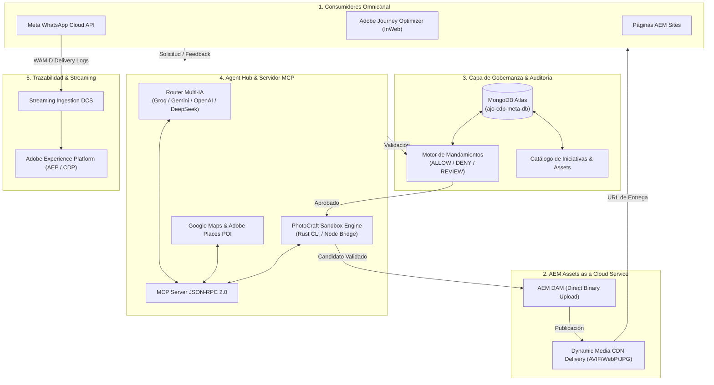

# 🏦 Martech Engineer — Dynamic Media, AEM Assets, Adobe Journey Optimizer & AI Agent Hub

[](pom.xml)
[](Dockerfile)
[](agent-hub/services/governanceEngine.mjs)
[](mcp-server/mcp_server.mjs)
[](photocraft/)

> **Principio Rector:** *Orquestar, Gobernar y Auditar.*  
> **AEM Assets / DAM** mantiene los activos binarios oficiales y la entrega CDN vía **Dynamic Media**.  
> **MongoDB Atlas** custodia el catálogo de iniciativas, mandamientos de marca y auditoría inmutable.  
> **Agent Hub & MCP** orquestan proveedores de IA y el motor de edición **PhotoCraft**, impidiendo alucinaciones y garantizando revisión humana (*Human-in-the-Loop*).

---

## 📑 Tabla de Contenidos

1. [Arquitectura de Solución](#-arquitectura-de-solución)
2. [Estructura del Proyecto y Carpetas](#-estructura-del-proyecto-y-carpetas)
3. [Router Multi-Proveedor de IA y Rotación de API Keys](#-router-multi-proveedor-de-ia-y-rotación-de-api-keys)
4. [PhotoCraft: Integración y Servidor MCP](#-photocraft-integración-y-servidor-mcp)
5. [Gobernanza con MongoDB Atlas y Mandamientos Anti-Alucinación](#-gobernanza-con-mongodb-atlas-y-mandamientos-anti-alucinación)
6. [Contexto Geográfico: Google Places & Adobe Places](#-contexto-geográfico-google-places--adobe-places)
7. [Flow Studio: Generador Dinámico de Entendimiento](#-flow-studio-generador-dinámico-de-entendimiento)
8. [Guía de Ejecución en Local](#-guía-de-ejecución-en-local)
9. [Dockerización y GitHub Actions](#-dockerización-y-github-actions)
10. [Hoja de Ruta de Integración Bancaria](#-hoja-de-ruta-de-integración-bancaria)

---

## 🏛️ Arquitectura de Solución



---

## 📂 Estructura del Proyecto y Carpetas

El repositorio está **100% alineado**: el archivo raíz `pom.xml`, los flujos de GitHub Actions, Dockerfile y el servidor de agentes conviven armónicamente sin carpetas anidadas redundantes.

```
.
├── pom.xml                               # Reactor raíz Maven AEM (12 módulos)
├── Dockerfile                            # Imagen multi-stage: AEM + Node.js + PhotoCraft
├── docker-compose.yml                    # Orquestación de servicios en local
├── package.json                          # Dependencias y scripts de Agent Hub & MCP
├── .env.local                            # Credenciales locales (ignorado en Git)
├── .env.example                          # Plantilla documentada de variables de entorno
│
├── core/                                 # Módulo Java OSGi: Servlets, Sling Models y servicios
├── ui.apps/                              # Componentes AEM, dialogs y clientlibs (/apps)
├── ui.apps.structure/                    # Definición de estructura de repositorio JCR
├── ui.config/                            # Configuraciones OSGi por runmode (author, publish)
├── ui.content/                           # Paquete de contenido DAM de muestra y filtros FileVault
├── ui.frontend/                          # Pipeline Webpack / React para componentes AEM
├── all/                                  # Paquete general AEM (All-in-one para Cloud Manager)
├── it.tests/                             # Pruebas de integración Java / Sling
├── dispatcher/ & dispatcher.ams/         # Reglas de Apache / Dispatcher y caché
├── ui.tests/                             # Pruebas funcionales Cypress para Cloud Service
│
├── photocraft/                           # 🦀 Motor Rust PhotoCraft (apps, crates, recipes)
│   ├── apps/photocraft-cli/              # Binario CLI con soporte `photocraft-cli batch` y `mcp`
│   ├── crates/automation/                # Motor de automatización y servidor MCP nativo
│   └── jobs/                             # Workspace aislado para transformaciones por Job ID
│
├── agent-hub/                            # 🚀 Orquestador de Agentes, API REST & Dashboard
│   ├── server.mjs                        # Servidor HTTP Express (Dashboard en :3000)
│   ├── services/
│   │   ├── providerRouter.mjs            # Router con rotación de keys y fallback de modelos
│   │   ├── governanceEngine.mjs          # Validación de mandamientos en MongoDB Atlas
│   │   ├── photocraftAdapter.mjs         # Adaptador puente aislado para PhotoCraft
│   │   └── placesService.mjs             # Enriquecimiento con Google Places y Adobe Places
│   ├── db/
│   │   └── seed_mongo_governance.mjs     # Seeder de iniciativas, mandamientos y catálogo
│   ├── public/                           # Dashboard web interactivo (Dark Mode, Spectrum Style)
│   └── tests/                            # Suites de pruebas automáticas (Gobernanza, Router, PhotoCraft)
│
├── mcp-server/                           # 🔌 Servidor Model Context Protocol (JSON-RPC 2.0)
│   └── mcp_server.mjs                    # Exposición de herramientas para agentes Claude/Cursor/AGY
│
├── flow_studio/                          # ⚡ Flow Studio: Entendimiento Dinámico
│   ├── generator.mjs                     # Inyector de modelos JSON a mapas interactivos
│   └── public/index.html                 # UI de diseño, inspección de nodos y descarga HTML
│
└── resources/                            # 📚 Material de entendimiento y handoffs técnicos
    ├── flow-template.html                # Plantilla base de diagramas interactivos
    ├── diagrama en html modelo.html      # Diagrama de referencia BCP WhatsApp + AJO + Azure
    └── ARRANQUE_PROYECTO_*.md            # Notas de continuidad técnica
```

---

## 🤖 Router Multi-Proveedor de IA y Rotación de API Keys

El archivo `agent-hub/services/providerRouter.mjs` implementa un enrutador inteligente de alta resiliencia:

1. **Soporte Multi-Key:** Permite especificar múltiples claves separadas por comas (ej. `GEMINI_API_KEY=key1,key2,key3`).
2. **Detección de Cuotas & Rate Limits (429):** Ante un error 429, aplica un cooldown automático a la clave y rota a la siguiente clave del pool.
3. **Fallback en Cascada:**
   - **Intento 1:** Groq LPU (`openai/gpt-oss-120b`) — Inferencia ultrarrápida (< 1.2s).
   - **Intento 2:** Google Gemini (`gemini-1.5-flash` / Pro) — Capacidad multimodal de texto y visión.
   - **Intento 3:** OpenAI (`gpt-4o-mini` / DALL-E) — Generación multimodal de soporte.
   - **Intento 4:** DeepSeek (`deepseek-chat`).
   - **Contingencia Local:** Si todas las APIs externas fallan, el motor conmuta a una plantilla determinista segura para nunca detener el flujo.
4. **Modo Embebido Adobe Firefly:** Cuando el repositorio se conecte a los servidores de Adobe con la cuenta oficial del banco, el router conmuta a **Adobe Firefly Services**, reemplazando las APIs de terceros no permitidas.

---

## 🎨 PhotoCraft: Integración y Servidor MCP

PhotoCraft es un motor de composición gráfica escrito en Rust que permite a los agentes ejecutar recetas deterministas sin arriesgar los binarios oficiales de AEM.

### Herramientas MCP Expuestas (`mcp-server/mcp_server.mjs`):

| Herramienta MCP | Descripción | Parámetros Clave |
| :--- | :--- | :--- |
| `photocraft_edit_asset` | Aplica transformaciones de recorte, compresión, watermark y perfiles de color en un sandbox aislado. | `jobId`, `sourceImagePath`, `actions`, `outputFormat` |
| `aem_asset_governance_check` | Evalúa si la iniciativa, intención y brief cumplen con los mandamientos de BCP en MongoDB. | `initiativeId`, `intention`, `briefText`, `channel` |
| `aem_asset_publish_delivery` | Publica el candidato aprobado en Dynamic Media, valida el MIME y registra en el catálogo. | `assetId`, `initiativeId`, `title`, `deliveryFormat` |
| `geo_places_enrichment` | Enriquece el brief con contexto de sedes y ambientes aprobados (Google Places / Adobe Places). | `locationQuery`, `eventType` |
| `router_generate_creative_brief` | Sintetiza un brief creativo seguro utilizando el router de modelos de IA con auto-rotación. | `userPrompt`, `initiativeId` |

---

## 🛡️ Gobernanza con MongoDB Atlas y Mandamientos Anti-Alucinación

La base de datos `ajo-cdp-meta-db` en **MongoDB Atlas** actúa como el cerebro de control de políticas:

* **Colección `initiatives`:** Guarda los identificadores oficiales (`INIT-BCP-CAMP-2026-01`, `INIT-BCP-CARD-2026-02`), canales autorizados y descargos legales obligatorios.
* **Colección `governance_mandamientos`:** Contiene los términos prohibidos que bloquean alucinaciones comerciales (ej. *"100% garantizado"*, *"sin evaluación"*, *"dinero fácil"*).
* **Colección `asset_catalog`:** Inventario de activos verificados con sus URLs de entrega en Dynamic Media y vigencias contractuales.
* **Colección `audit_log`:** Bitácora inmutable (*Append-Only*) que registra qué agente, modelo y aprobador humano autorizó cada activo.

> **Regla Fail-Closed:** Ante caídas de red o dudas en los derechos de autor, el motor nunca concede un `ALLOW` probabilístico. Asigna `REVIEW_REQUIRED` y exige aprobación humana.

---

## 📍 Contexto Geográfico: Google Places & Adobe Places

* **Google Places API:** Permite descubrir ubicaciones corporativas y sugerir paletas de ambientación (ej. *arquitectura moderna de vidrio en La Molina*, *skyline financiero en San Isidro*, *arcos coloniales de piedra en Cusco*).  
  *Cumplimiento de Términos:* Solo se persiste el `place_id` y metadatos permitidos, sin almacenar fotos binarias no autorizadas.
* **Adobe Places Service:** Maneja POIs y geovallas orientadas a la activación en apps móviles y Journey Optimizer cuando existe consentimiento del cliente.

---

## ⚡ Flow Studio: Generador Dinámico de Entendimiento

Ubicado en `flow_studio/` e integrado en el Agent Hub:

* **Visualización Dinámica:** Carriles por tecnología (*AEM DAM, PhotoCraft, Azure Agent Hub, AJO, Meta WhatsApp, AEP CDP*).
* **Animación de Tokens:** Recorrido interactivo paso a paso mostrando origen, destino, protocolo y el payload JSON exacto en tránsito.
* **Drawer de Inspección:** Al hacer clic en cualquier nodo, se despliegan sus entradas, salidas, reglas de negocio y posibles puntos de falla.
* **Exportación Standalone:** Permite exportar mapas HTML 100% interactivos y autocontenidos sin dependencias externas para compartir con otros equipos o IAs.

---

## 🚀 Guía de Ejecución en Local

### 1. Prerrequisitos
* **Node.js** v20 o superior
* **Java JDK 21** & **Apache Maven 3.9+**
* **Docker Desktop** (opcional para ejecución en contenedores)

### 2. Configurar Variables de Entorno
Copia la plantilla y valida las claves (el proyecto ya incluye soporte para tu archivo `.env.local`):
```bash
cp .env.example .env.local
```

### 3. Inicializar Base de Datos en MongoDB Atlas
Ejecuta el seeder para poblar iniciativas, mandamientos y catálogo:
```bash
npm run seed
```

### 4. Ejecutar las Pruebas de Diagnóstico
Comprueba que el motor de gobernanza, el router multi-IA y el adaptador PhotoCraft funcionen al 100%:
```bash
npm run test:governance
npm run test:photocraft
npm run test:router
```

### 5. Levantar el Agent Hub & Dashboard
```bash
npm start
```
* **Dashboard del Hub:** [http://localhost:3000](http://localhost:3000)  
* **Flow Studio Dinámico:** [http://localhost:3000/flow_studio/index.html](http://localhost:3000/flow_studio/index.html)  
* **API de Proveedores:** [http://localhost:3000/api/providers](http://localhost:3000/api/providers)

### 6. Ejecutar Servidor MCP para Agentes
```bash
npm run mcp
```

### 7. Compilar los Paquetes AEM
Desde la raíz del proyecto:
```bash
mvn clean install
```
*(Para saltar tests unitarios y agilizar el empaquetado: `mvn clean install -DskipTests`)*.

---

## 🐳 Dockerización y GitHub Actions

### Levantar con Docker Compose
```bash
docker compose up --build -d
```
El contenedor compilará los artefactos AEM, iniciará el servidor del Agent Hub y dejará expuesto el puerto `3000`.

### GitHub Actions CI/CD (`.github/workflows/docker-build-push.yml`)
El flujo automatizado compila el proyecto y publica la imagen en **Docker Hub** en cada push a las ramas `main` o `master`:
* **Secretos Requeridos en GitHub:**
  * `DOCKERHUB_USERNAME`: Usuario de Docker Hub.
  * `DOCKERHUB_TOKEN`: Access Token de Docker Hub (o contraseña).

---

## 🎯 Hoja de Ruta de Integración Bancaria

1. **Alineación Completada:** Estructura de carpetas unificada, Maven raíz validado al 100%, Git apuntando a la raíz del proyecto.
2. **Gobernanza Operativa:** MongoDB Atlas conectado con mandamientos de marca activos y detección de alucinaciones.
3. **PhotoCraft Adaptado:** MCP Server y sandbox de trabajo operativos para edición reproducible de activos.
4. **Flow Studio Listo:** Mapas interactivos reproducibles para documentación técnica y coordinación inter-IA.
5. **Próximo Hito (Producción Adobe):** Vinculación de credenciales corporativas en Adobe Developer Console (`App Builder` UI Extension en AEM Assets) y habilitación de **Adobe Firefly Services**.
